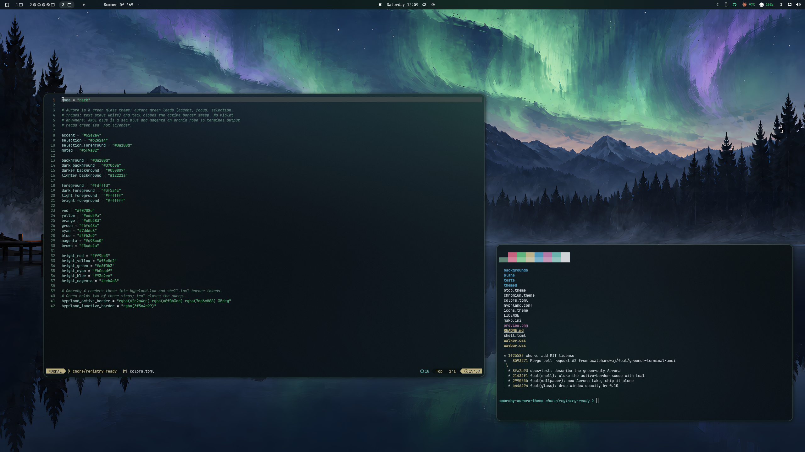

# Omarchy Aurora Theme

Aurora uses **#85D9AC** for focus, **#EDF7EF** for reading text and **#B0C8BC** for secondary labels. Nautilus and Waybar layer local dark backings over a 2% **#0E1613** base. The desktop wallpaper is Aurora Lake.



Wallpaper: "Aurora Lake" is an AI-generated illustration commissioned for this theme, upscaled 4x with Real-ESRGAN and fitted to 3840×2160.

## Installation

On a fresh desktop, install the color theme and its wallpaper:

```sh
omarchy-theme-install https://github.com/axatbhardwaj/omarchy-aurora-theme
```

If Aurora already exists, update the clean checkout to the intended release. The install command replaces an existing checkout, so first inspect `git -C ~/.config/omarchy/themes/aurora status --short` and preserve local work.

For native glass, review the theme's `desktop/` files, then run these as the logged-in desktop user. Omarchy's Git-theme installer intentionally excludes executable Lua and terminal configurations. This separate, explicit step installs local, reviewed includes.

```sh
python3 ~/.config/omarchy/themes/aurora/desktop/install.py
if command -v omarchy >/dev/null; then omarchy theme set aurora; else omarchy-theme-set aurora; fi
```

The installer adds a local include to GTK 4 and to existing Hyprland Lua and terminal configs. It keeps an exact adjacent `.before-aurora-desktop` copy before editing each existing file. It preserves symlinks and conflicting owned assets for manual reconciliation. Alacritty installations with a custom import layout or main-file opacity get a specific merge instruction. Run it again after installing an additional terminal.

Omarchy 4 renders into `~/.local/state/omarchy/current/theme`. The trusted Lua include runs **after** looknfeel and glass-mode toggles, when those might otherwise reset blur to size 4/passes 2 or fade Files to 75%. It checks the selected theme on every reload. Existing global templates are preserved. Omarchy 3.5's Hyprland 0.53+ config reads the shipped `hyprland.conf` under `~/.config/omarchy/current/theme`; host-specific overrides loaded later take precedence.

A theme-set hook switches only Aurora's supplemental terminal and GTK includes. Leaving Aurora selects empty includes and lets the next theme supply the palette. The hook supports both the single-file and drop-in hook dispatchers, restores installed Yaru-olive icons after Omarchy 4 sets Adwaita, and reloads supported terminals in a Wayland session. The headless setter skips hooks. After headless staging, enter the desktop session and reselect Aurora. On a headless host with neither theme setter nor graphical session, there is no Omarchy desktop to apply.

## Discord (Vencord / Vesktop)

`vencord/aurora.theme.css` is a [ClearVision v7](https://github.com/ClearVision/ClearVision-v7) preset in the Aurora palette: green accents, green-black glass shading, Aurora Lake behind the app. Copy it to `~/.config/Vencord/themes/` (Vesktop: `~/.config/vesktop/themes/`) and enable it under Settings → Vencord → Themes.

## T3 Code

From the theme checkout, publish Aurora to the local T3 environment. The regular JPEG beside the JSON supplies the wallpaper. The JSON includes a gradient fallback for import-only clients.

```sh
themes="${T3CODE_HOME:-$HOME/.t3}/userdata/themes"
install -d "$themes"
install -m 644 backgrounds/0-aurora-lake.jpg "$themes/aurora.jpg"
t3 theme set --id aurora ./t3code.json
```

Every T3 pane uses one flat 46% lake ink scrim over the 2% tint, centred like the desktop wallpaper. With T3 at 92% window opacity this matches Ghostty's 0.4316 background.

T3 blurs its own copy of the wallpaper by only 24 px. A tiled or full-height window therefore centres the sharp aurora core behind the reading area. Ghostty instead sees the desktop under Hyprland's much wider blur. To stop those bright green bands, a `darken`-blended crest (`#365a58`) caps each wallpaper channel before the pane blur. It changes only the brightest ~30% of the lake, leaving darker detail, the green accent and the 45% black message bubbles unchanged. On a side-by-side capture at the same monitor, the brightest 0.5% of text-free T3 background fell from sRGB luma 98 to 51. Ghostty measured 55.

A new thread has no timeline rows yet, so T3 fills the conversation pane with an opaque empty-timeline placeholder (`[data-timeline-loading]`). Aurora makes it transparent so the new-thread pane shows the same lake, crest and blur as existing chats.

T3 opens Usage and Settings in one app modal (`[data-app-modal]`) filled with the opaque canvas over a 64% canvas backdrop. Aurora scopes glass to that modal only. Its backdrop drops to 24% lake ink, and the modal uses 44% lake ink with a 24 px blur. The Settings nav and cards use 34% with the same blur, because the nav overlays content on narrow windows and diagnostics headers stick over rows. Alerts, ordinary dialogs, chart tooltips and Appearance previews keep their T3 fills, and no rule changes content opacity. `tests/check-t3code-theme.mjs` keeps body and muted text at 4.5:1 or better over the brightest fill behind the modal, the selected-thread accent on the crest peak.

T3 fills the right-hand pull request panel and its Summary, Timeline and Code views with the opaque canvas. When that panel shows a pull request, Aurora gives it the same fixed lake, crest and blur as the conversation, so the lake runs on across both panes. Sticky section headers use 30% lake ink with a 24 px blur. Timeline cards, the reply box and the Code toolbar use 34%. Timeline badges become a clear blur that still hides the rail. Outline buttons, label chips and the diff view keep their T3 fills, so diff colours are unchanged.

A Markdown file opened in the right-hand panel also gets the panel lake while its rendered preview shows. This covers inline, maximized and narrow-window sheet layouts. Its tab strip, breadcrumbs, reading pane and file explorer drop their opaque canvas. Source view, other file types, the active tab and pressed file controls keep their T3 fills. The test keeps headings, 90% body text, muted quotes, accent links and inline code at 4.5:1 or better over the brightest lake, and T3's 50% focus ring at 3:1.

Fenced code blocks in chat and pull request descriptions use 55% black glass instead of the opaque code background. Syntax colours, copy and wrap buttons are unchanged. The test keeps every pierre-dark syntax colour within 95% of its contrast on the stock code background, even over the brightest lake.

T3 draws Mermaid diagrams itself and takes every colour from `--pele-*` roles. Aurora sets those roles on the diagram:

- **Nodes** use 62% lake-ink glass instead of the slate `secondary` tile.
- **Outlines** use 60% sage, at 3:1 or better against nodes and subgraphs.
- **Series colours** (pie, charts, git graphs) come from Aurora's palette. There is no purple, and slice labels stay at 4.5:1.

Subgraphs keep the accent surface, edges stay sage, accent stays `#85d9ac` and critical marks stay Aurora's error red. Mermaid `style` and `classDef` colours still win.

**Expand** copies these roles into an image. It also stamps the page body's colour behind the diagram, and that colour is T3's navy chrome. Aurora clears the body's background; `html` paints the same chrome, so the app looks unchanged. The expanded diagram then shows the viewer surface through its transparent pixels.

In the English T3 client the expanded diagram's blob image is named `Mermaid diagram`. Aurora uses that name to tint the viewer and blur the underlying lake. Other localized names receive T3's default viewer styling. Back, gallery controls and ordinary photos retain their existing styling. Run `node tests/check-t3code-mermaid.mjs` (needs Chromium; set `CHROMIUM` to its binary if it is not on `PATH`). It renders T3's diagram markup and its Expand serializer, then checks both views.

Select **Aurora** for dark appearance if the client has a separate theme selection. For Omarchy's automatically generated `omarchy.json` alias, install the same JPEG as `omarchy.jpg`. Run `node tests/check-t3code-theme.mjs` to check the palette and fallback contrast, and `node tests/check-no-purple.mjs` to keep violet and magenta fills out of every shipped surface (ANSI magenta slots excepted).

## Desktop surfaces

| Surface | Applied behavior |
| --- | --- |
| Hyprland | Size 24, four Dual Kawase passes, neutral brightness/contrast and xray. Active borders are 2 px green; idle tiled borders are 1 px neutral. Hyprland's kernel differs from the design's Gaussian blur. |
| Files (Nautilus 51/GTK 4) | Window tint at 2%, sidebar gradient 44% to 30%, header 40%, reading area 42% to 20%. A 20% green wash and 3 px rail mark the selected place. The icon theme supplies real green folder artwork. GTK reads user CSS when the process starts. |
| Ghostty, kitty, Alacritty, foot | Native background-only opacity, with fully opaque glyphs at the compositor. These configs expose one background alpha. The profile uses the brighter-wallpaper endpoint of the reading scrim: `0.42 + 0.02 × 0.58 = 0.4316`, with the composite RGB rounded to `#0A100D`. Start a new window to pick up launch-only settings. |
| Waybar / Omarchy 4 bar | Waybar draws the 42% backing over the 2% tint and adds a text halo. The native shell accepts a single bar color and alpha, so it receives the equivalent composite. Omarchy 4.5’s built-in bar caps `glassy` at 0.35 and clears `none`. Select `omarchy-bar background opaque` to use the supplied 0.4316 alpha. The Aurora layer rule still enables blur. Menus, notifications and security prompts retain stronger backings. |

Other applications continue using their existing native or compositor opacity policies. The desktop integration targets Nautilus (Haoshoku's Super+E binding). Another file manager will use its own widgets.

## Approved io glass preset (2026-11-05)

The [io glass restore preset](presets/io-glass-2026-11-05/README.md) preserves
Axat's approved desktop appearance and is also backed up in Haoshoku:

- Ghostty: 70% native background opacity, fully opaque terminal text.
- T3 Code: 92% compositor opacity for readable text with subtle glass.
- Other apps: 80%; browsers: 90%; credential and media exceptions retained.
- Omarchy window and bar modes: `glassy`; effective blur size 4, passes 2.
- Captured Aurora palette, shell styling, wallpaper, and personal window rules.

This is an explicit restore preset, not automatically applied by theme install.
Restoring this snapshot deliberately returns the older compositor settings.
The archive manifest contains SHA-256 hashes; follow its README to restore.
T3 uses whole-window opacity, so its text fades slightly; Ghostty uses native
background-only transparency. No T3 palette change is needed for this preset.

## Verify in the graphical session

```sh
hyprctl configerrors
hyprctl getoption decoration:blur:size
hyprctl getoption decoration:blur:passes
hyprctl getoption general:col.active_border
hyprctl getoption general:col.inactive_border
hyprctl layers
readlink ~/.config/aurora-desktop/active
gsettings get org.gnome.desktop.interface icon-theme
gtk4-query-settings gtk-icon-theme-name
ghostty +show-config | grep -E '^(background|background-opacity|foreground) = '
```

Expect 24, four passes, the green and neutral border colors, profile `lake`, Yaru-olive, Ghostty opacity 0.4316 and ink #EDF7EF. Install the Yaru icon set containing `/usr/share/icons/Yaru-olive/index.theme` if absent. Check the active bar namespace with `hyprctl layers`. Inspect focus/idle borders by alternating focus between Files and a terminal. When file operations are complete, quit Files normally and reopen it. Check its header, sidebar selection, labels and folder artwork against both the sky and lake. Native contrast varies with wallpaper placement, scale, GTK renderer and display.

To remove the integration, remove its include from each app and its hooks from `~/.config/omarchy/hooks` before removing `~/.config/aurora-desktop`. Compare the adjacent backups before restoring, so newer personal edits survive. Switch themes to refresh icons and reload running apps.

## Theme Locations

After installation, certain theme files need to be manually moved to their respective locations:

### Vencord Theme
Move the Vencord theme file to:
```
~/.config/Vencord/themes/
```

Or if using Vesktop:
```
~/.config/vesktop/themes/
```

### Who
Made by [Bjarne Oeverli](https://x.com/iamdothash) using [Aether](https://github.com/bjarneo/Aether).
